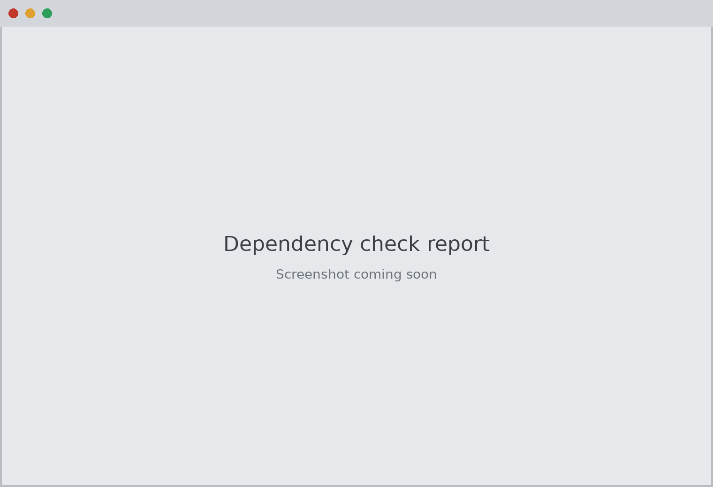

# Dependency check

[Back to README](../README.md)



The check runs in the background at every launch. The status bar shows the result;
click it, or use Help > Check dependencies, to see the full report. The report window
opens on its own when something fails, or when there is a warning (you can turn off
the warning case).

| Check | Error | Warning |
| --- | --- | --- |
| Python | Older than 3.10 | Past end of life |
| PySide6-Essentials, shiboken6, configupdater, pyte, pywinpty (Windows) / ptyprocess (macOS) | Missing or below the minimum | A minor or major version behind PyPI |
| AWS CLI | Missing, v1, or older than 2.9 | A minor version behind the latest v2 release |
| Terminal | No usable terminal (macOS: `osascript` missing) | Windows Terminal not installed |
| AWS config | Does not parse | Missing; writable by other users; owned by someone else; profile names with control characters |
| AWS credentials | | Readable or writable by other users |
| Environment | | Running as admin/root; relative entries in PATH |

Being a patch release behind is reported as info only, because the AWS CLI ships patch
releases almost daily. Every finding includes a fix command, and "Copy fix commands"
puts them all on the clipboard.

The same check runs from the command line and exits 1 on errors:

```bash
python -m termswitch --check            # includes latest-version lookups (or: tsw --check)
python -m termswitch --check --offline  # minimums only, no network
```

The latest-version lookup makes HTTPS requests to `pypi.org/pypi/<package>/json`,
the AWS CLI v2 changelog on `raw.githubusercontent.com`, and the latest termSwitch release on `api.github.com`. Certificates are verified,
responses are size-capped, and nothing is sent except a User-Agent string. You can turn
the lookup off in Settings > Dependencies, which also has a button to run the check
now.
