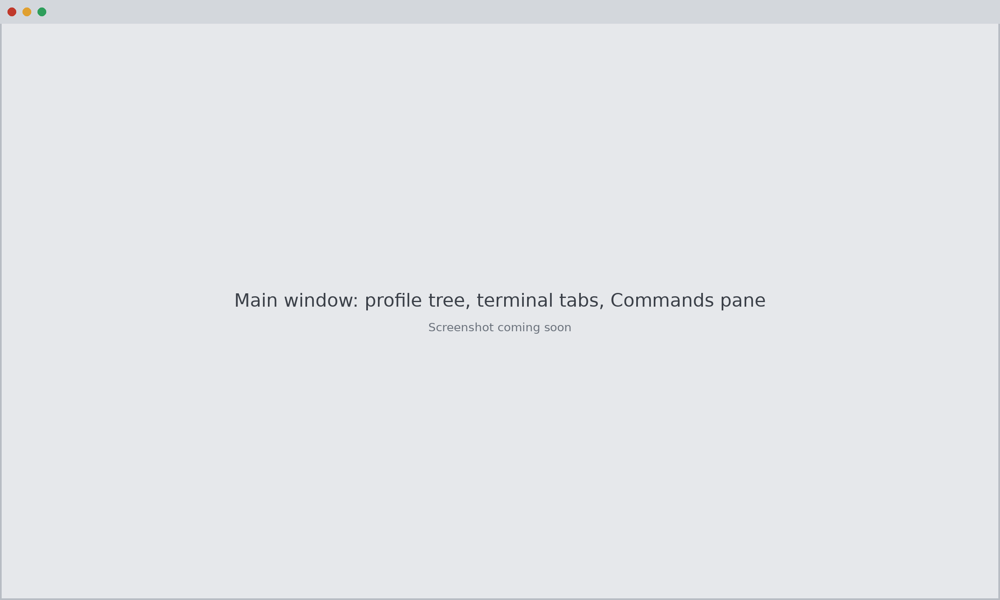
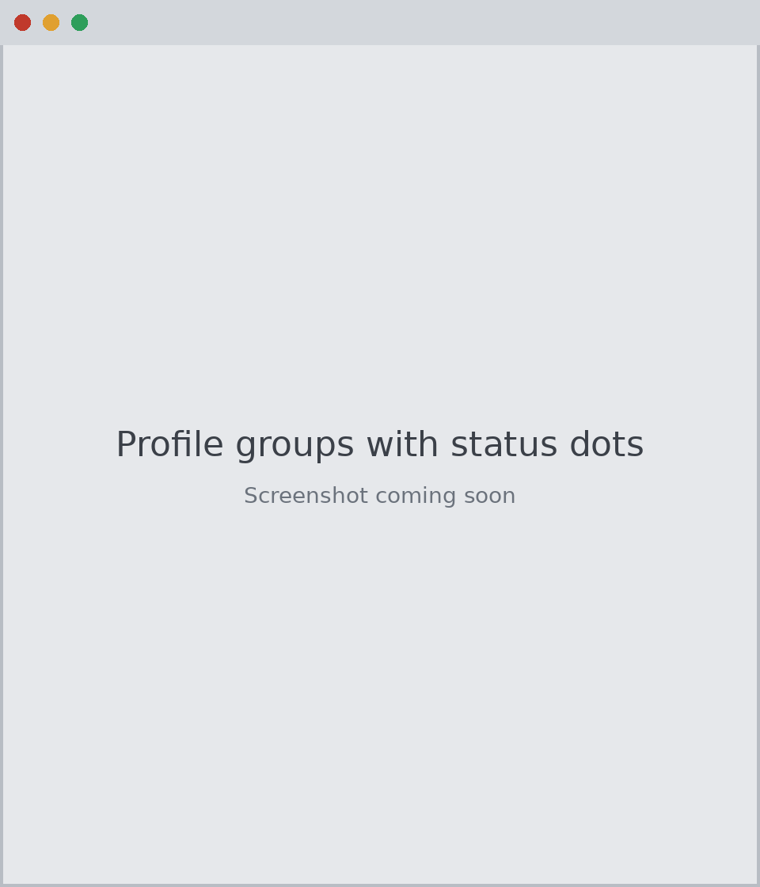
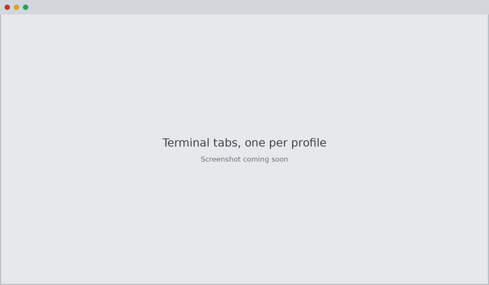
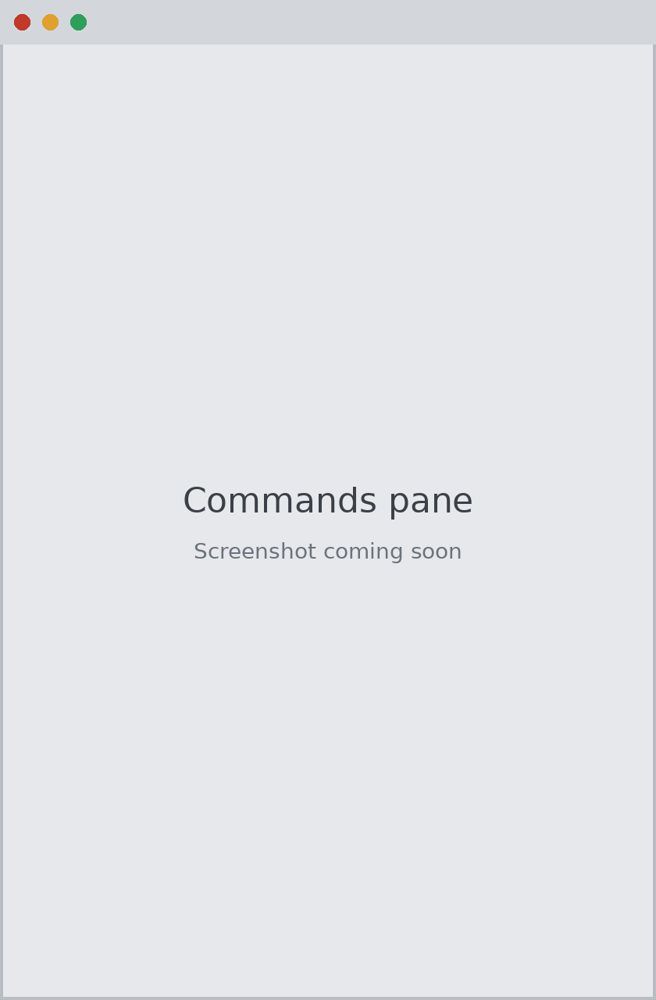
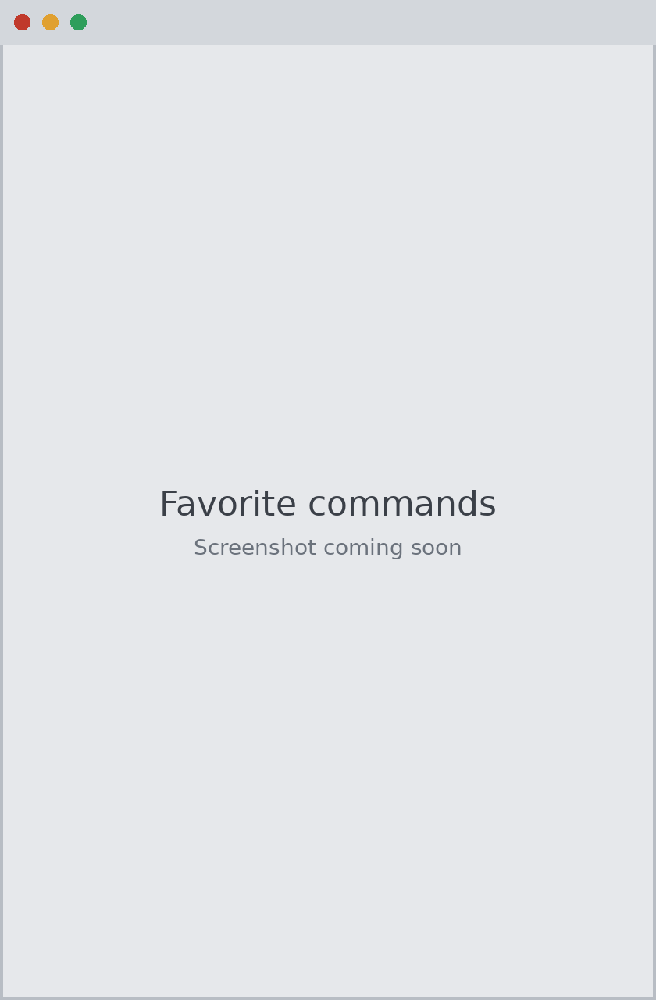
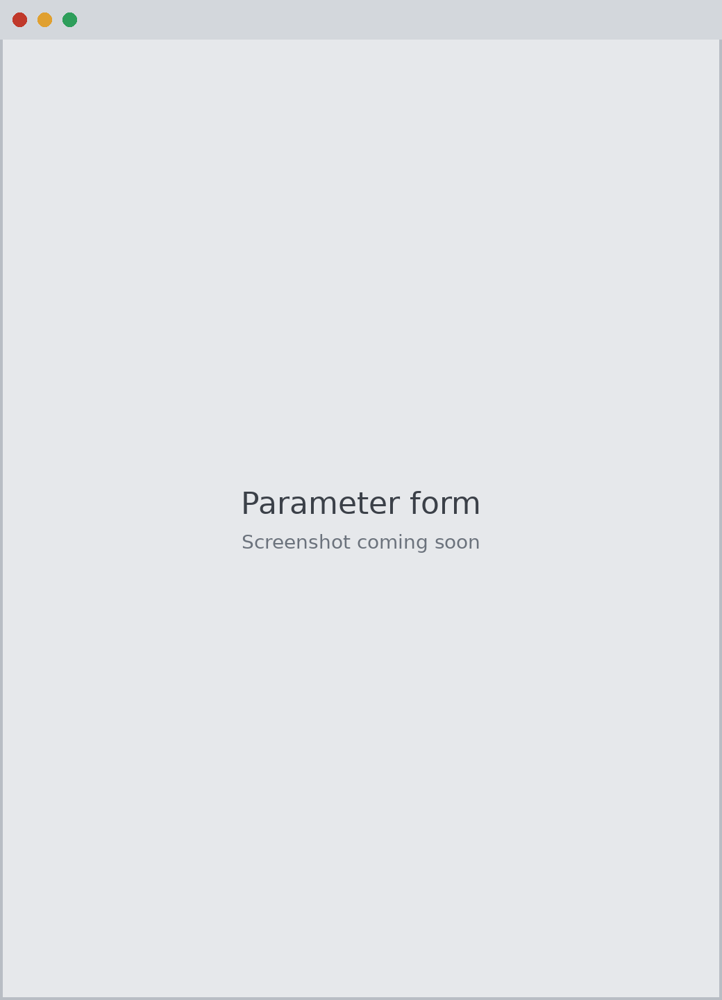
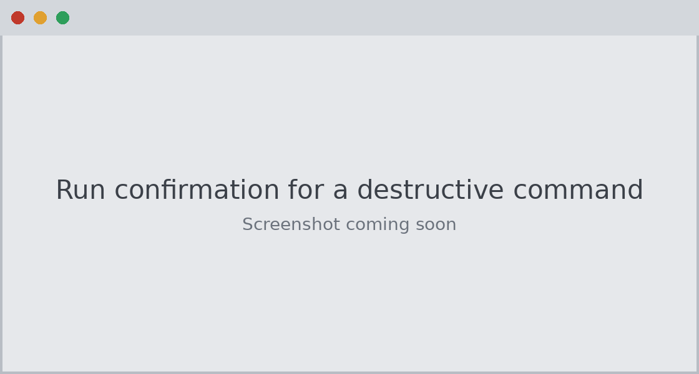
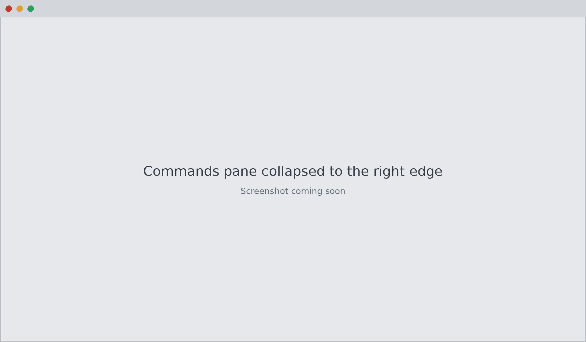
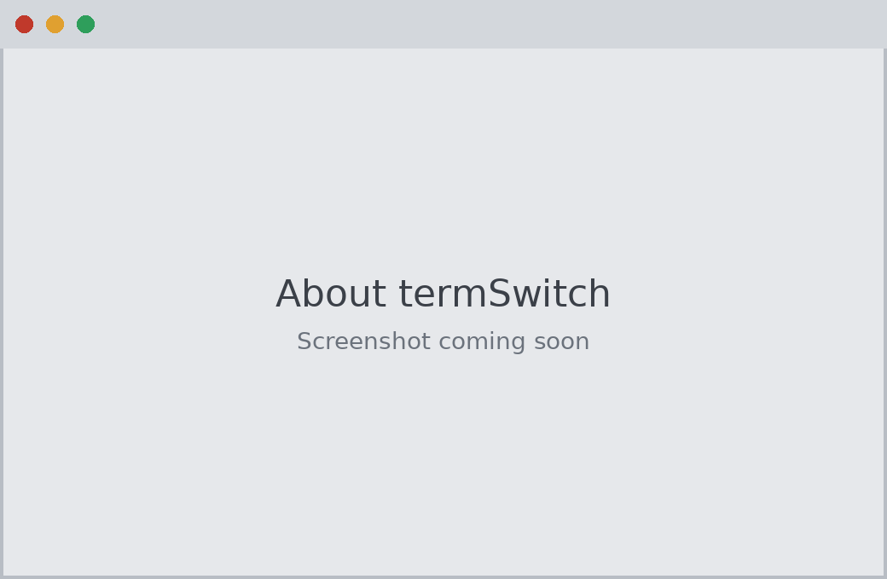

# Using termSwitch

[Back to README](../README.md)

- [The main window](#the-main-window)
- [Getting started without a config](#getting-started-without-a-config)
- [Profiles and groups](#profiles-and-groups)
- [Managing profiles](#managing-profiles)
- [Managing the config file](#managing-the-config-file)
- [Terminal tabs](#terminal-tabs)
- [Commands pane](#commands-pane)
- [Favorite commands](#favorite-commands)
- [Parameter form](#parameter-form)
- [Run safety](#run-safety)
- [Collapsing the Commands pane](#collapsing-the-commands-pane)
- [Credential status and SSO](#credential-status-and-sso)
- [About termSwitch](#about-termswitch)

## The main window



The window has three parts: the profile tree on the left, terminal tabs in the middle,
and the Commands pane on the right.

## Getting started without a config

When there's no `~/.aws/config` yet, or it has no profiles, the profile tree is replaced
by a welcome panel with three choices:

1. **Set up AWS SSO** (recommended if your organization uses IAM Identity Center):
   1. Create an SSO session: a name, your access portal's start URL, and the SSO region.
   2. Then pick one of:
      - **Sign in and pick accounts:** runs `aws configure sso` in a new tab. At its first
        prompt, enter the session name. The AWS CLI opens your browser to sign in, lists
        the accounts and roles you can use, and saves a profile. Run it again for each
        account and role you want. New profiles appear in the tree as soon as they're
        saved.
      - **Add a profile by hand:** enter an account ID and role name yourself.
2. **Add a profile:** opens the profile editor described below.
3. **Use an existing config file:** points termSwitch at another file. termSwitch sets
   `AWS_CONFIG_FILE` for its status checks and new terminal tabs, so the AWS CLI uses
   the same file. **File > Use the default config file** switches back.

If the AWS CLI isn't installed, the panel says so and links to the dependency check.

## Profiles and groups



Each AWS profile shows an orange cloud marked "AWS", with a dot in the top-right corner
for its credential status: grey for not checked, green for signed in, orange for expired or
not logged in, and red for an error. SSH sessions, when they arrive, will use a teal
terminal icon.

| Action | How |
| --- | --- |
| Open terminal tab | Double-click, Enter, Ctrl+T, or right-click (single-click is an option) |
| Open in external terminal | Shift+double-click or Ctrl+Shift+T |
| Open several | Multi-select then Enter, or right-click a group > Open all |
| Move | Drag profiles or groups onto a group |
| New group | Toolbar or Ctrl+Shift+N (`A/B` makes nested groups) |
| Rename / delete group | F2 / right-click > Delete (contents move up one level) |
| Status | Check all (Ctrl+Shift+R), or right-click |
| SSO login | Button or right-click (opens your browser) |
| Tab color | Right-click a profile > Set tab color |
| New profile | Toolbar, Ctrl+N in the tree, or right-click a group > New profile here |
| Edit profile | Edit button, Ctrl+E in the tree, or right-click > Edit |
| Rename profile | F2, or right-click > Rename |
| Delete profile | Delete (Cmd+Backspace on macOS), or right-click > Delete |
| Undo the last change | Profiles > Undo, or Ctrl+Z (Cmd+Z) in the tree |

The tree shortcuts only work while the tree has focus, so Ctrl+N and Ctrl+Z still reach
the shell in a terminal tab.

### How groups are stored

Groups live in `~/.aws/config`, so they follow the file to any machine. Drag and drop
rewrites only the lines it needs to, and comments and formatting are kept.

```ini
[profile acme-prod-admin]
sso_session = acme
sso_account_id = 111111111111
sso_role_name = AdministratorAccess
region = us-west-2
x_group = Acme/Prod
x_color = #c0392b
```

Groups with no profiles yet are kept here so they survive a reload:

```ini
[x-termswitch]
groups = Acme/Sandbox
```

Botocore, the AWS CLI and the SDKs ignore keys and sections they do not recognize.
Profiles without `x_group` appear in italic automatic groups. By default those are
grouped by SSO session or credential type; change it under View > Group untagged
profiles by. Dropping a profile on an automatic group, or on empty space, removes its
`x_group`.

## Managing profiles

**New profile** opens a form with three profile types:

- **AWS SSO (IAM Identity Center):** an SSO session, an account ID and a role name.
  **New...** next to the session list creates a session without leaving the form.
- **Assume a role:** a role ARN and a source profile, plus an optional external ID, MFA
  device, session name and duration.
- **Custom:** any settings, entered in the **Other settings** table.

Every type also has region, output format and group. The form checks values before
saving: profile names can't contain `[`, `]` or control characters, account IDs must
be 12 digits, role ARNs and regions must be well formed, and names must be unique.

**Edit** shows the same form for an existing profile:

- Only the settings you change are written. Everything else in the profile, including
  comments, nested settings such as `s3 =` blocks, and keys the form doesn't know
  about, stays exactly as it was.
- Static keys (`aws_access_key_id`, `aws_secret_access_key`) are shown masked and
  read-only. termSwitch never writes them; use `aws configure`, or better, AWS SSO.
- A `credential_process` setting shows a warning, because it runs a program every
  time the profile is used.

**Rename** asks whether to update other profiles that use the old name as their
`source_profile`. Scripts and environment variables that use the old name aren't
changed.

**Duplicate** copies a profile's settings, except static keys, and opens the copy in
the editor.

**Delete** works on one or several selected profiles. It warns when other profiles use
a deleted profile as their `source_profile`, and when a profile also has keys in
`~/.aws/credentials`, which termSwitch doesn't change (so it stays in the list).

Open terminal tabs for a renamed or deleted profile keep running with the old
`AWS_PROFILE`. Their tab title says "(renamed)" or "(deleted)", and they can't be
duplicated.

**Production profiles** (matching the production pattern in Settings) need a second
confirmation to rename or delete: type the profile name.

**Undo** reverses the last change to the config, including deletes, renames, restores
and resets. Undoing again redoes it. If the file was changed outside termSwitch since,
undo is refused; use **File > Backups** instead.

## Managing the config file

The **File** menu has tools for the whole config:

- **SSO sessions:** list, add, edit and delete `[sso-session]` sections. Deleting a
  session that profiles still use lists them first.
- **Add profiles from AWS SSO:** runs `aws configure sso` in a tab, as in the setup
  steps above.
- **Edit config file:** an editor with highlighting for sections, settings and comments.
  - It checks the text as you type, and Save stays disabled until the file parses. The
    line with the problem is underlined.
  - It warns if the file changed on disk while you were editing.
  - It won't open, or save, a config that contains access keys or session tokens. Use
    **Open in external editor** for those.
- **Backups:** termSwitch's backups of the config, newest first, with a preview.
  Restoring backs up the current file first.
- **Reset config:** moves the config aside as a backup and shows the welcome panel. The
  old file is kept, and can be restored from Backups or with Undo. A symlinked config
  (for example from a dotfiles repo) is never reset.

## Terminal tabs



Each profile opens in its own tab:

- PowerShell on Windows (through ConPTY), your login shell on macOS
- colored tabs (red for production)
- 10,000 lines of scrollback, and full-screen programs such as `less`, `vim` and the
  `aws ... help` pager
- Shift+double-click, or Ctrl+Shift+T, opens the profile in Windows Terminal or iTerm2
  instead. Change the default under Settings > Open profiles in.

### Keyboard shortcuts

| Action | Windows | macOS |
| --- | --- | --- |
| Copy | Ctrl+Shift+C, or Ctrl+C with text selected | Cmd+C |
| Paste | Ctrl+V or Ctrl+Shift+V | Cmd+V |
| Close tab | Ctrl+Shift+W | Cmd+W |
| Next / previous tab | Ctrl+Tab / Ctrl+Shift+Tab | same |
| Focus profiles / terminal | Ctrl+1 / Ctrl+2 | same |
| Show / hide Commands | Ctrl+Shift+K | Cmd+Shift+K |
| Find a command | Ctrl+Shift+F | Cmd+Shift+F |
| Favorite the selected command (Commands pane) | Ctrl+D | Cmd+D |
| Scroll back | Shift+PgUp / PgDn, mouse wheel | same |
| Clear scrollback | right-click > Clear scrollback | Cmd+K |

Other keys work as usual: Ctrl+C interrupts, Ctrl+R searches history, and Tab completes.

### Tab menu and shell startup

Right-click a tab to duplicate, rename, restart (after the shell exits), or open the same
profile in an external terminal.

On macOS, a tab starts your normal login shell (zsh, bash or fish) with all of your
startup files, then re-applies the tab's profile last.

- If a startup file sets `AWS_PROFILE` or exports AWS keys, the tab keeps its own profile,
  removes the keys, and prints a one-line note.
- Your files are loaded unchanged, and zsh's `ZDOTDIR` is restored afterwards.
- On Windows, PowerShell's profile script runs before termSwitch sets the profile, so the
  tab's profile always wins there too.

### Pasting and closing

Pasting text with more than one line asks first, since each line could run as a command.
Pasted text is stripped of control characters and escape sequences, and is sent as a
bracketed paste when the shell supports it, so it can't inject keystrokes. Clipboard
(OSC 52) and hyperlink (OSC 8) escape sequences from programs are ignored.

Closing a tab that is running a command asks first. On Windows, any live shell counts.
Quitting termSwitch with terminals open asks first, then ends them.

## Commands pane



To the right of the terminal tabs is a **Commands** pane listing every AWS CLI command,
modeled on PowerShell ISE's Commands view.

- **Service:** pick a service, or All. Each entry shows its full name, for example
  `ec2 (Amazon Elastic Compute Cloud)`.
- **Name:** filter as you type. `describe-inst` or `s3 cp` both work. Press Enter to
  jump to the first match.
- **The list:** alphabetical, with letter headers. Hover a command for its description.
- **Double-click:** inserts the bare `aws <service> <command> ` at the prompt.

## Favorite commands



Star the commands you use most so they're one click away.

- **Starring:**
  - the star next to the command name in the parameter form
  - right-click a command > **Add to favorites** or **Remove from favorites**
  - Ctrl+D (Cmd+D on macOS) while the Commands pane has focus. In a terminal tab,
    Ctrl+D still goes to the shell.
- **Finding them:**
  - **Favorites (N)**, directly under All in the Service list, shows only favorites,
    sorted by service and name. The Name filter works there too.
  - With **All** selected and the Name filter empty, a **Favorites** section appears
    above the A-Z list.
  - Favorites show a star wherever they appear.
- **Starter favorites:** on first run, termSwitch adds five everyday commands:
  `sts get-caller-identity`, `s3 ls`, `s3 cp`, `ec2 describe-instances` and
  `logs tail`. They're added once and are yours to remove. If you already have
  favorites, the starters are added after them. To add back any you removed,
  right-click in the Favorites view > **Restore default favorites**; your own
  favorites are kept.

  Earlier versions added 30 starters. If you never changed that list, upgrading
  trims it to the five above and keeps any favorites you added yourself. If you
  did change it, it's left as it is.
- **Storage:** favorites are saved in termSwitch's own settings, never in
  `~/.aws/config`.
- **After an AWS CLI upgrade:** a favorite the installed CLI no longer has stays in the
  list, grayed out, with a tooltip naming the CLI version. Remove it with right-click.
- **Moving them to another computer:** in the Favorites view, right-click >
  **Export favorites...** saves a JSON file, and **Import favorites...** merges one in.
  Entries that aren't valid `service command` names are skipped.

## Parameter form



Selecting a command shows a form built from its service model, like ISE's Show-Command
panel:

- **Required:** marked with `*` and listed first. Run and Insert stay disabled until
  they are filled in.
- **Optional:** collapsed when there are many, with a filter box. Each option shows the
  model's description as a tooltip.
- **Field types:**
  - drop-downs for enum values
  - whole-number fields for integers
  - on/off/not-set choices for flags. The CLI's renamed negations are used, for example
    `--no-reboot` / `--reboot`.
  - space-separated lists
  - a JSON or shorthand editor for nested options, with an **Example** button
  - `fileb://` hints for binary input
- **Common:**
  - `--region` (shows the profile's region), `--output`, `--query`
  - `--dry-run`, where the operation supports it
  - pagination options for paginated commands: `--no-paginate`, `--max-items`,
    `--page-size`, `--starting-token`
  - free-form extra arguments
- **Output file:** commands that write their result to a file, such as
  `s3api get-object` and `lambda invoke`, ask for an output file.
- **Live preview:** the **Command** box shows exactly what will be typed, quoted for the
  tab's shell (PowerShell on Windows, POSIX on macOS).
  - In PowerShell, values containing double quotes (such as JSON) are passed as
    `file://` references to private temp files, which are removed when termSwitch
    exits. PowerShell 5.1 and 7 hand embedded quotes to native programs differently, so
    this is the only form that works in both.
- **Buttons:**
  - **Run** types the command and presses Enter.
  - **Insert** types it without pressing Enter.
  - **Copy** copies it.
  - **Docs** opens the AWS CLI reference page.
## Where the command list comes from

The list comes from **the AWS CLI you have installed**, so it always matches your
version:

- **Source:** CLI v2 ships the botocore service models inside its install, and termSwitch
  reads them from there.
- **Naming:** the CLI's own service and command names are used. `s3api`, `deploy` and
  `configservice` keep their CLI names, and commands the CLI removes are left out.
- **Extra commands:** a curated list adds commands that aren't in the models, such as
  `s3 cp`/`sync`, `sso login`, `configure`, `logs tail`, `eks update-kubeconfig` and
  `ecr get-login-password`.
- **Caching:** the index is cached per CLI version, so later launches are instant.
  **Refresh** rescans, for example after you upgrade the CLI.
- **Cache location:**
  - Windows: `%LOCALAPPDATA%\termSwitch\cache`
  - macOS: `~/Library/Caches/termSwitch`

## Run safety



- Run always asks first for destructive commands: `delete-*`, `terminate-*`, `remove-*`,
  `deregister-*`, `disable-*`, `revoke-*`, `detach-*`, `purge-*`, `s3 rm/rb/mv`, and
  `s3 sync --delete`.
- On a production profile, Run also asks before any command that changes something.
- The prompt shows the profile, the account and the exact command, and Cancel is the
  default.
- Insert never runs anything.

## Collapsing the Commands pane



- The **X** collapses the pane to a thin "Commands" tab on the right edge. Click the tab
  to bring it back.
- Ctrl+Shift+K toggles the pane, and Ctrl+Shift+F jumps to the Name filter.
- The pane remembers whether it was open, and its width.

## Credential status and SSO

- **Status dots.** Green, orange or red dots come from `aws sts get-caller-identity`,
  which runs in the background.
- **SSO login.** When an SSO profile needs a login, `aws sso login` runs automatically in
  the new terminal. You can also log in from the app. One login refreshes every profile
  on that SSO session.
- **Production safeguards.** Profiles that match a pattern (`prod` by default) show in
  red and get a red tab color. By default, termSwitch asks before opening one.

## About termSwitch



**Help > About** (in the termSwitch menu on macOS) shows the version and, for
downloaded builds, the commit it was built from. Source checkouts show the base version
followed by "(source)".

- **Links:** the project website, the GitHub repository, the release notes for the
  version you're running, a pre-filled bug report with your version and OS, and the
  licenses.
- **Update status:** downloaded builds check for a newer release in the background,
  unless Settings turns off checking for newer versions. Nothing is shown when the
  check can't reach GitHub.
- **System information:** versions of termSwitch, the OS, Python, Qt, PySide6 and the
  AWS CLI, the terminal backend and the config file path. **Copy** puts it on the
  clipboard for a bug report. It never includes profile names, account IDs, ARNs or
  credentials.
